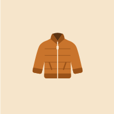
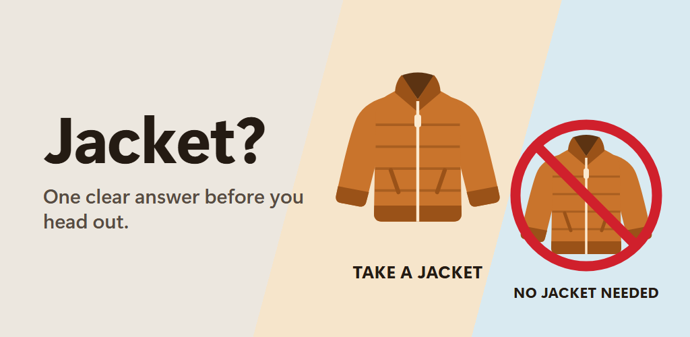
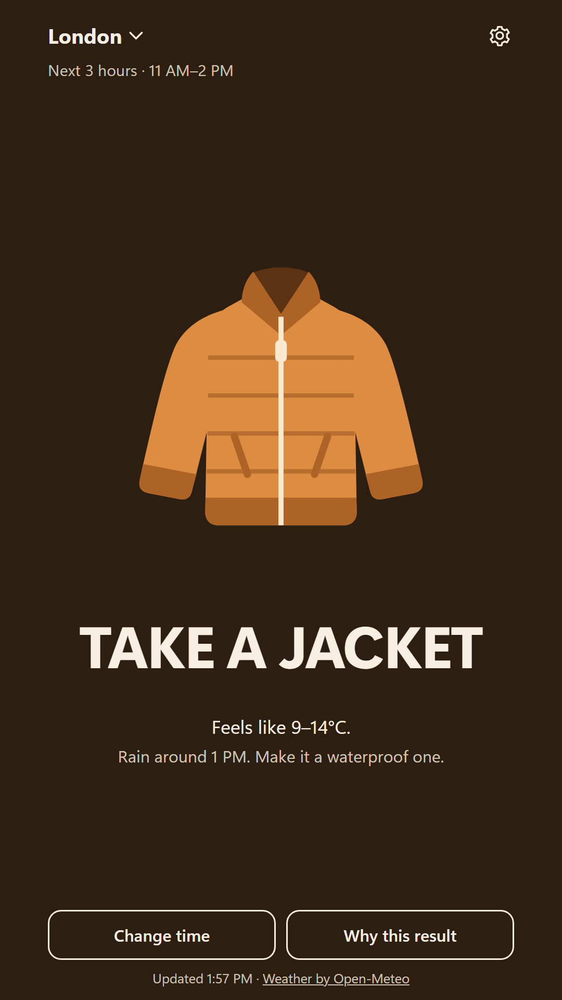
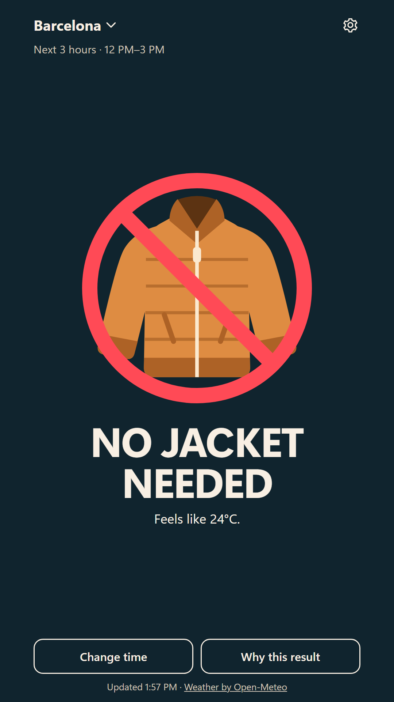
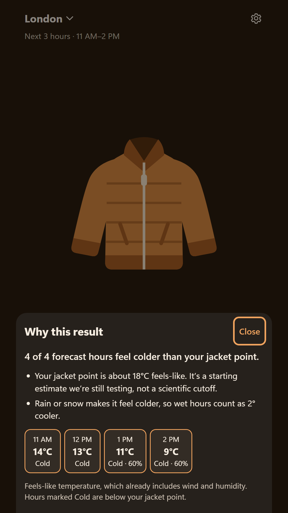
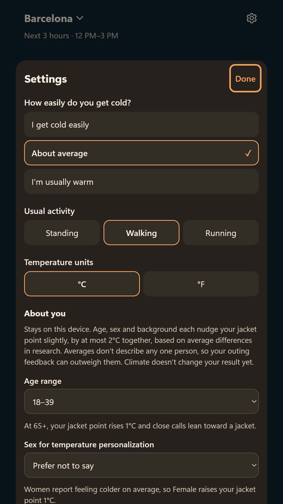

<p align="center">
  
</p>

<h1 align="center">Jacket?</h1>

<p align="center">
  <strong>Take a jacket or not. One tap, one answer.</strong><br>
  For where you're going, and the hours you'll be out.
</p>

<p align="center">
  <a href="https://takeajacket.com/"></a>
  <a href="https://takeajacket.com/download/"></a>
</p>

<p align="center">
  
</p>

## What it does

Jacket? checks the hourly **"feels like"** forecast for your place and time window, compares it with your own jacket point, and shows one big answer: **TAKE A JACKET** or **NO JACKET NEEDED**.

- **Your time window:** right now, the next 3 hours, the rest of today, or this evening. Long-press the app icon to jump straight to one.
- **Tuned to you:** how easily you get cold, what you'll be doing, and optionally your age, sex and background. It also learns from how your outings went.
- **Honest:** "Close call" when it's borderline, "Why this result" shows the forecast behind every answer, and it never guesses when data is missing.
- **Rain is separate advice:** a waterproof layer isn't always a warm one.
- **Private:** no account, no ads, no tracking. Settings stay on the device, and locations are rounded to about 1 km before the forecast request.

<p align="center">
  
  
  
  
</p>

## Get it

| Where | How |
|---|---|
| **Any phone or computer** | Open [takeajacket.com](https://takeajacket.com/). On Android choose ⋮ → **Install app**; on iPhone choose Share → **Add to Home Screen**. |
| **Android APK** | [takeajacket.com/download](https://takeajacket.com/download/) |
| **Google Play** | In closed testing. Coming soon. |

## How it decides

The rules live in [`js/engine.js`](js/engine.js) and are pure functions with tests.

1. **Your jacket point**, in feels-like °C: 21 if you get cold easily, 18 if you're average, 17 if you run warm. Standing adds 2 and running subtracts 6. Optional profile details move it by up to ±2, and outing feedback by up to ±3.
2. **Each forecast hour** in your window is compared with that point. Rain or snow counts as 2 °C colder. Wind and sun are already part of the feels-like temperature.
3. **Take a jacket** when a third of the outing is below your point, or two hours are clearly below it (by 3 °C or more), or any hour is far below it (6 °C or more). Results within 1.5 °C are marked "Close call".

These numbers are product hypotheses from the research report, and they are being tuned from real use.

## Run it locally

No build step and no dependencies.

```bash
python -m http.server 5173 --bind 127.0.0.1
```

Open http://localhost:5173. Engine tests run at http://localhost:5173/tests/.

## Project layout

| Path | Purpose |
|---|---|
| `index.html`, `css/app.css` | The app screen. |
| `js/engine.js` | Decision rules, thresholds and forecast windows. Pure and tested. |
| `js/weather.js` | Open-Meteo forecast and geocoding, with the on-device cache. |
| `js/store.js` | Saved preferences (localStorage only). |
| `js/app.js` | Screens, sheets, onboarding and shortcut handling. |
| `sw.js` | Offline app shell. Bump `CACHE` when releasing. |
| `download/` | Android download page and APK. |
| `privacy.html` | Privacy policy. |
| `store/` | Google Play listing text and graphics. |
| `.well-known/assetlinks.json` | Lets the Android app open the site full screen. |

## Before a paid launch

- **Weather licence:** the free Open-Meteo API is non-commercial. Move to a paid plan or another provider before adding ads. All provider code is in `js/weather.js`.
- **Severe weather:** notices come from forecast values, not an official alert feed.
- **Demographic nudges:** sex, age and background adjustments (`SEX_SHIFT`, `AGE_SHIFT`, `ANCESTRY_SHIFT`) are unvalidated guesses from research averages, capped at ±2 °C together. Climate is stored but unused.

## Credits

Weather data by [Open-Meteo.com](https://open-meteo.com/) (CC BY 4.0). Made by One Answer Apps. [Privacy policy](https://takeajacket.com/privacy.html).
